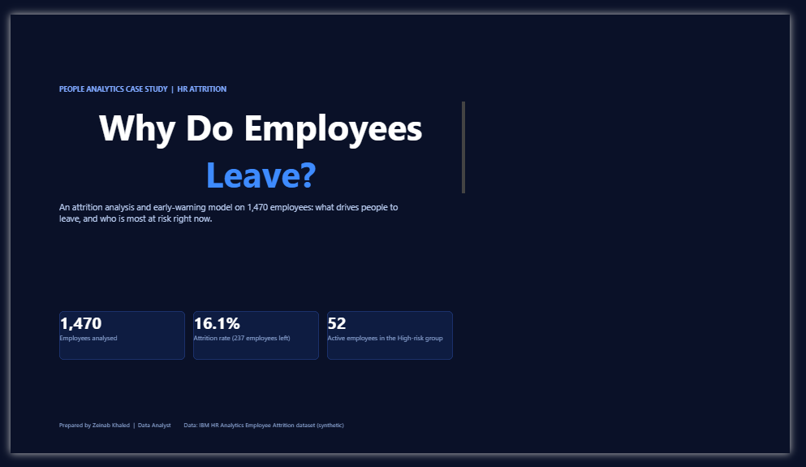
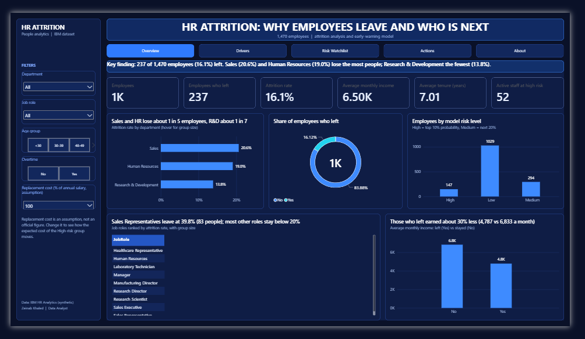
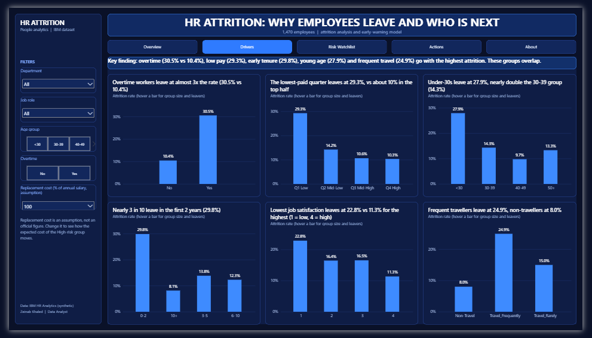
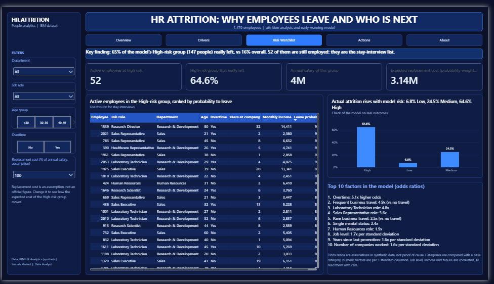
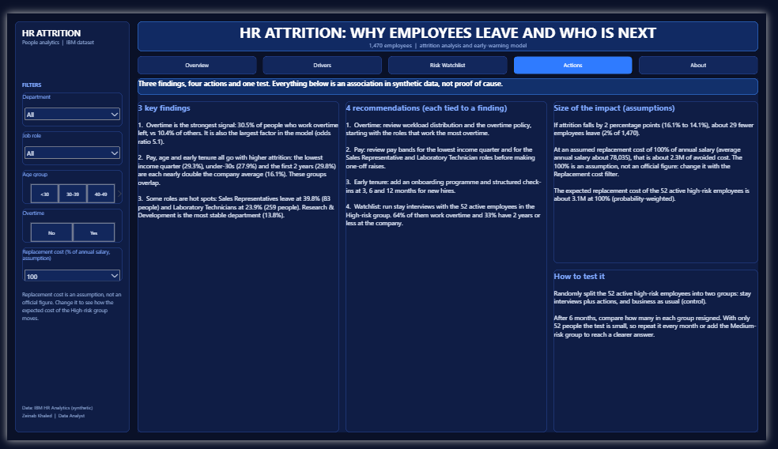

# Why Do Employees Leave, and Who Is Likely to Leave Next?

> **An HR attrition case study: what drives people to resign, and an early-warning model that flags who to talk to first. Built with Excel, Python (scikit-learn) and Power BI.**



---

## 📌 Executive Summary

An HR director asks: **why are employees leaving, who is most likely to leave next, and what can we do before we lose them?**

I analysed **1,470 employees (237 left, 16.1%)**, measured attrition as a **rate** (not just a count), built an explainable logistic regression model, and delivered the results in an interactive Power BI dashboard with a ranked watchlist.

**What the data says**

- **Overtime is the strongest signal.** 30.5% of employees who work overtime left, vs 10.4% of the others (almost 3x). Overtime workers are 28% of staff but **54% of all leavers**.
- **Pay, age and early tenure go with high attrition.** The lowest-paid quarter leaves at 29.3%, under-30s at 27.9% and people in their first 2 years at 29.8%, each nearly double the company average.
- **Some roles are hot spots.** Sales Representatives leave at **39.8%** (83 people) and Laboratory Technicians at 23.9% (259 people).
- **The model finds the people at risk.** Of the 147 employees the model ranks highest (the top 10%), **64.6% really left**, 4x the 16.1% base rate. That group contains 40% of all leavers.
- **52 current employees are in that High-risk group.** They are the stay-interview list: 64% work overtime and 33% joined within the last 2 years.
- **The prize is real but depends on an assumption.** Cutting attrition by 2 percentage points means about 29 fewer leavers; at an assumed replacement cost of 100% of annual salary, that is about 2.3M in avoided cost.

---

## 🎯 Business Problem

Every resignation costs money: recruiting, training and lost productivity. Most companies only see the total number of leavers, not *why* they leave or *who is next*, so they react after the resignation instead of before it.

### Business Questions

1. What is the overall attrition rate, and which departments and roles are affected most (as a **rate**, with group size)?
2. Which factors go with higher attrition: overtime, pay, age, tenure, travel, satisfaction?
3. Which factors matter most when considered together (model)?
4. Which **current** employees are most likely to leave next?
5. What should HR do, and how big is the opportunity?

---

## 📊 Dataset

| Item | Detail |
|---|---|
| **Source** | IBM HR Analytics Employee Attrition & Performance (Kaggle). Please check the dataset page for its license |
| **Size** | 1,470 employees, 35 original columns |
| **Target** | `Attrition` (Yes / No): 237 left, 1,233 stayed (16.1%) |
| **Nature** | **Synthetic data** created by IBM data scientists. The patterns illustrate a method, not a real company |
| **Quality** | No missing values; 3 constant columns (`EmployeeCount`, `StandardHours`, `Over18`) removed |

---

## 🔄 Approach (Google Data Analytics framework)

### 1. ASK

- **Stakeholder:** the HR director.
- **Decision:** where to focus retention effort, and with which employees.
- **Success criterion:** the director can open the dashboard and, in about 10 seconds, see the attrition rate, the main drivers and a list of people to talk to this week.

### 2. PREPARE

- Reviewed the data dictionary, missing values, duplicates and constant columns.
- Kept `EmployeeNumber` as a key to join the model output, but excluded it from the model features.
- **Decision:** always compare **rates with group size**, never counts alone. A role with 30 leavers out of 100 is riskier than one with 100 out of 2,000.

### 3. PROCESS (Excel)

- Converted the data to an Excel Table (`Employees`) and removed the constant columns.
- Added formula-driven columns:

| Column | Rule |
|---|---|
| `AttritionFlag` | 1 if Attrition = Yes, else 0 |
| `AgeGroup` | <30, 30-39, 40-49, 50+ |
| `TenureGroup` | years at company: 0-2, 3-5, 6-10, 10+ |
| `IncomeBand` | quartiles of monthly income: Q1 Low, Q2 Mid-Low, Q3 Mid-High, Q4 High |

- Built an **Analysis** sheet with live formulas: attrition rate (average of `AttritionFlag`), group size and leavers for every group, a **small-sample warning (n < 30)** and conditional formatting for rates above the company average.

### 4. ANALYZE

**Attrition rate by driver (company average: 16.1%)**

| Driver | Group (rate, n) |
|---|---|
| **Overtime** | Yes: **30.5%** (416) · No: 10.4% (1,054) |
| **Income quartile** | Q1 Low: **29.3%** (369) · Q2: 14.2% · Q3: 10.6% · Q4 High: 10.3% |
| **Age group** | <30: **27.9%** (326) · 30-39: 14.3% · 40-49: 9.7% · 50+: 13.3% |
| **Tenure** | 0-2 years: **29.8%** (342) · 3-5: 13.8% · 6-10: 12.3% · 10+: 8.1% |
| **Business travel** | Frequently: **24.9%** (277) · Rarely: 15.0% · None: 8.0% |
| **Marital status** | Single: **25.5%** (470) · Married: 12.5% · Divorced: 10.1% |
| **Job satisfaction** | 1 (low): **22.8%** (289) · 4 (high): 11.3% |
| **Department** | Sales: 20.6% (446) · Human Resources: 19.0% (63) · R&D: 13.8% (961) |

**Highest-attrition job roles**

| Job role | Attrition rate | Employees |
|---|---:|---:|
| Sales Representative | 39.8% | 83 |
| Laboratory Technician | 23.9% | 259 |
| Human Resources | 23.1% | 52 |
| Sales Executive | 17.5% | 326 |
| Research Scientist | 16.1% | 292 |

**The model** (`notebooks/attrition_model.ipynb`)

- **Logistic regression** in a scikit-learn `Pipeline`: standard scaling for numeric columns and one-hot encoding for categorical ones, with `class_weight="balanced"` because only 16% of employees leave.
- **80/20 stratified split** (294 test employees). The baseline "nobody will leave" is 83.9% accurate and useless, so accuracy is not used on its own.

| Metric (test set) | Value |
|---|---:|
| Recall for leavers | 0.66 (31 of 47 found) |
| Precision for leavers | 0.36 |
| F1 for leavers | 0.46 |
| ROC-AUC | 0.80 |
| PR-AUC (average precision) | 0.57 |

- **Why logistic regression:** it is simple and explainable. The coefficients tell HR *which factors* push the odds up.

**Top 10 factors (odds ratios)**

| # | Factor | Odds ratio |
|--:|---|---:|
| 1 | Overtime | 5.1 |
| 2 | Frequent business travel (vs no travel) | 4.9 |
| 3 | Laboratory Technician role | 4.8 |
| 4 | Sales Representative role | 3.6 |
| 5 | Rare business travel (vs no travel) | 2.5 |
| 6 | Single marital status | 2.4 |
| 7 | Human Resources role | 1.9 |
| 8 | Job level (per 1 std. dev.) | 1.7 |
| 9 | Years since last promotion (per 1 std. dev.) | 1.6 |
| 10 | Number of companies worked (per 1 std. dev.) | 1.6 |

> Categorical factors are compared with a base category; numeric factors are per one standard deviation. Job level, income and tenure are correlated, so these are associations, not independent effects.

**Risk scores for the watchlist** use **out-of-fold predictions** (5-fold cross-validation), so no employee is scored by a model that saw their own outcome. Employees are then ranked: **High** = top 10% probability (147), **Medium** = next 20% (294), **Low** = the rest (1,029).

| Model risk level | Employees | Actually left | Actual attrition rate |
|---|---:|---:|---:|
| High | 147 | 95 | **64.6%** |
| Medium | 294 | 72 | 24.5% |
| Low | 1,029 | 70 | 6.8% |

The High group is 10% of staff but holds 40% of all leavers (4x the base rate).

### 5. SHARE (Power BI)

An interactive dashboard with a cover page and one dashboard page with tab navigation (bookmarks), a dark navy and blue theme and five views:

| View | What it shows |
|---|---|
| **Overview** | KPIs, attrition by department, job roles ranked by rate with group size, income of leavers vs stayers |
| **Drivers** | Attrition rate by overtime, income, age, tenure, job satisfaction and travel (hover for group size) |
| **Risk Watchlist** | The active High-risk employees ranked by probability, the model check by risk level, top model factors, and an expected replacement cost |
| **Actions** | 3 findings, 4 recommendations, impact and a test plan |
| **About** | Method, model details and limitations |

Slicers: Department, Job role, Age group, Overtime, and a **what-if parameter** for the replacement cost (% of annual salary).






🎥 **Demo:** [Watch the walkthrough](ADD-YOUR-LINKEDIN-OR-VIDEO-LINK-HERE)

**Main DAX measures:** `Total Employees`, `Attrition Count`, `Attrition Rate`, `Avg Monthly Income`, `High Risk (Active)`, `High Risk Hit Rate`, `Annual Salary (High Risk Active)` and `Expected Replacement Cost (High Risk)`.

### 6. ACT

**3 key findings**

1. **Overtime** is the strongest signal: 30.5% vs 10.4%, and the largest factor in the model.
2. **Low pay, young age and early tenure** each go with attrition nearly double the company average. These groups overlap.
3. **Sales Representatives (39.8%) and Laboratory Technicians (23.9%)** are the hot spots; R&D is the most stable department (13.8%).

**Recommendations (each tied to a finding)**

| Finding | Recommended action |
|---|---|
| Overtime | Review workload distribution and the overtime policy, starting with the roles that work the most overtime |
| Low pay and hot-spot roles | Review pay bands for the lowest income quarter and for Sales Representatives and Laboratory Technicians before making one-off raises |
| Early tenure | Onboarding programme and structured check-ins at 3, 6 and 12 months |
| Watchlist | **Stay interviews** with the 52 active High-risk employees (Laboratory Technicians 16, Sales Representatives 10, Sales Executives 9) |

**Size of the impact (assumptions)**

- A **2-point reduction** in attrition (16.1% to 14.1%) means about **29 fewer leavers** (2% of 1,470).
- Average annual salary is about 78,000, so at an assumed replacement cost of **100% of annual salary** the avoided cost is about **2.3M**.
- The expected replacement cost of the 52 active High-risk employees (probability-weighted) depends on that assumption:

| Replacement cost (% of annual salary) | Expected cost, 52 employees |
|---:|---:|
| 50% | 1.6M |
| 100% | 3.1M |
| 150% | 4.7M |
| 200% | 6.3M |

> The replacement cost is **my assumption, not an official figure**. In the dashboard you can change it with the what-if filter.

**How to test it:** randomly split the 52 into two groups (stay interviews plus actions vs business as usual) and compare resignations after 6 months. With only 52 people the test is small, so repeat it monthly or add the Medium-risk group.

---

## ⚠️ Limitations

- **Synthetic data, one snapshot.** There are no hire or exit dates, so trends over time cannot be measured.
- **Associations, not causes.** Overtime may be a symptom of heavy workloads rather than the reason people leave.
- **Personal attributes in the model.** The model uses age, gender and marital status among its features. In a real company this must be reviewed for fairness first, and the watchlist should start conversations, not decide pay or promotion. A version without these attributes was not tested here.
- **Small test set.** Only 47 leavers are in the test split, so the metrics are indicative, not precise. At the default threshold, precision for leavers is 0.36.
- **Correlated features** (job level, income, tenure) make individual odds ratios hard to interpret.
- **Small groups** (for example the Human Resources job role has 52 people) should be read with caution; the Excel sheet flags groups with n < 30.
- **Replacement cost is an assumption.**
- **For educational purposes only.**

**Next steps:** compare with and without personal attributes, test a tree-based model against the logistic regression, and run the stay-interview experiment with a control group.

---

## 🔁 Reproduce this project

1. Open `excel/HR_Attrition_Analysis.xlsx` (sheet `Data` = the Employees table, sheet `Analysis` = live summary formulas).
2. Install the dependencies:
   ```bash
   pip install -r requirements.txt
   ```
3. Open `notebooks/attrition_model.ipynb` and run all cells. It reads `../excel/HR_Attrition_Analysis.xlsx` and writes `../data/processed/hr_attrition_scored.csv`.
4. Open the Power BI file in `powerbi/`. If the data source points to another folder, use **Transform data → Data source settings** to point it to `data/processed/hr_attrition_scored.csv`.

---

## 📁 Repository Structure

```text
HR-Attrition-Analysis/
│
├── data/
│   ├── raw/                       # original IBM dataset (check the license before sharing)
│   └── processed/
│       └── hr_attrition_scored.csv   # employees with AttritionProbability and RiskLevel
│
├── excel/
│   └── HR_Attrition_Analysis.xlsx    # Data (Employees table) + Analysis (live formulas)
│
├── notebooks/
│   └── attrition_model.ipynb         # logistic regression, evaluation, odds ratios, risk scores
│
├── powerbi/
│   └── HR_Attrition_Analysis_Dashboard.pbix
│
├── images/                           # dashboard screenshots
├── requirements.txt
├── .gitignore
└── README.md
```

---

## 🛠️ Tools

| Tool | Purpose |
|---|---|
| **Excel** | Cleaning, formula-driven groups, attrition rate with group size, small-sample flag |
| **Python** (pandas, scikit-learn, seaborn) | Logistic regression pipeline, evaluation, odds ratios, out-of-fold risk scores |
| **Power BI** (DAX) | Interactive dashboard, bookmarks navigation, what-if parameter |
| **GitHub** | Documentation and portfolio |

---

## 👩‍💻 Author

**Zeinab Khaled**
Data Analyst | Business Information Systems Graduate

- **Portfolio:** [zeinak112.github.io/my_portfolio](https://zeinak112.github.io/my_portfolio/)
- **LinkedIn:** [Zeinab Khaled](https://www.linkedin.com/in/zeinab-khaled-9a5ab8416/)

*Data: IBM HR Analytics Employee Attrition & Performance dataset (Kaggle). This project is not affiliated with IBM.*
